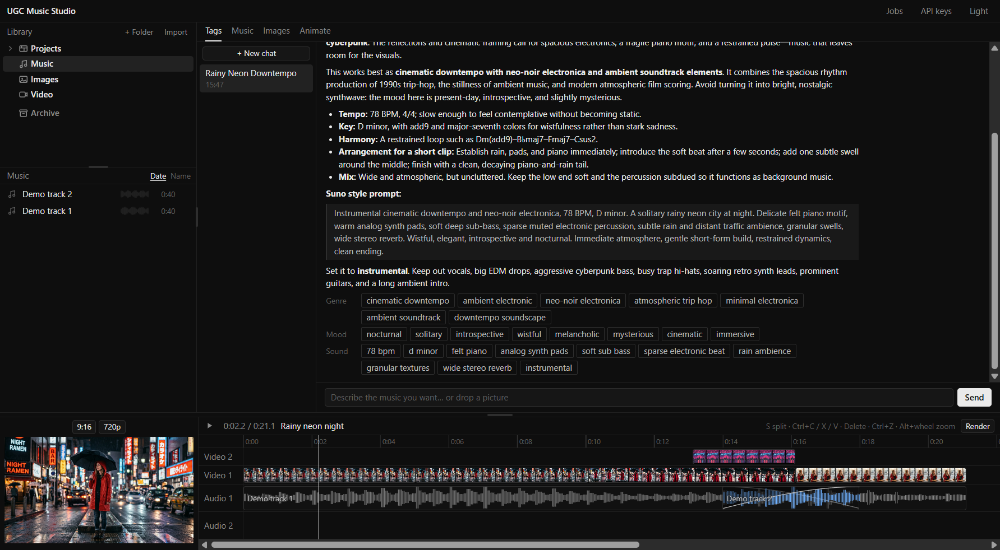
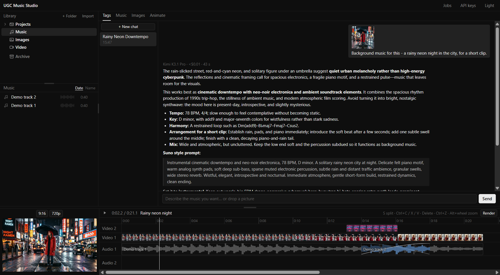
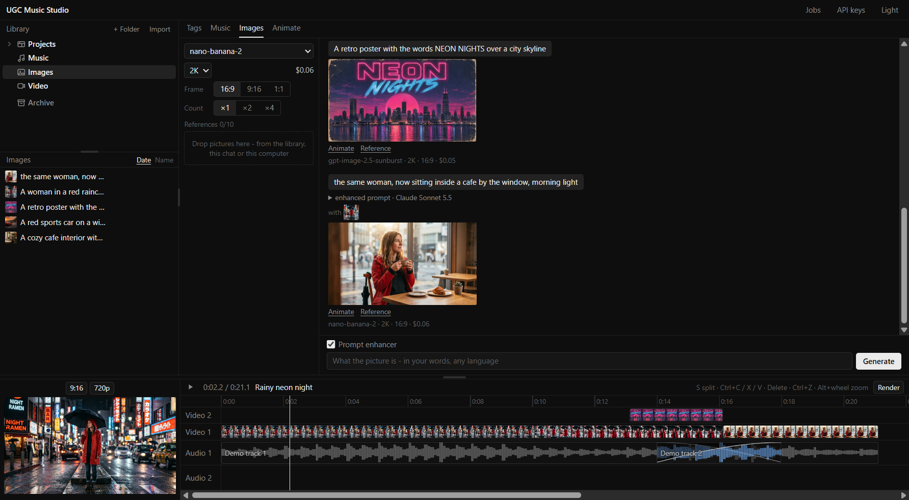
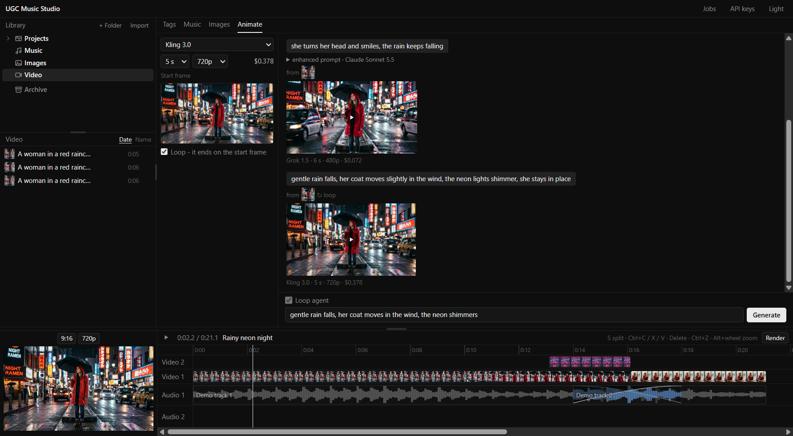
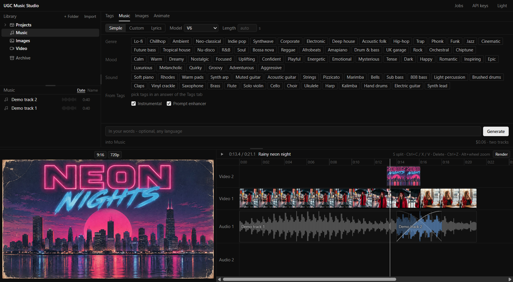

# UGC Music Studio

A small desktop studio for making music videos with AI: find the words for a sound, make the tracks with Suno, make
pictures and short animated clips, and put it all together on a timeline into one MP4. It runs on your own computer,
keeps everything in plain folders, and talks to the AI services with your own API keys.



## What it does

- **Tags** - a tag assistant. Describe the music you want in any language, or drop a picture: it reads the scene's
  vibe and answers with an explanation and genre, mood and sound tags to pick from. It talks about music only.
- **Music** - Suno through kie.ai: Simple (your words and the chips), Custom (your style and lyrics) and Lyrics.
  An optional prompt enhancer turns your choices into Suno's prompt. Two tracks per press.
- **Images** - pictures from nano-banana-2, nano-banana-2-lite, grok-imagine-image-2 and gpt-image-2.5-sunburst:
  1K / 2K / 4K where the model has them, 16:9, 9:16 or 1:1, one to four at a time, up to 10 reference pictures.
- **Animate** - a picture into a clip with Grok 1.5 or Kling 3.0 (3-15 s, 720p / 1080p / 4K). Kling can end on a
  last frame you choose, or **loop** back to its start frame; with Loop on, a loop agent looks at the picture and
  writes the motion so the clip comes back to where it began.
- **Library** - Music, Images and Video as real folders on disk: make, rename, move and nest folders; play, view,
  rename and move files; bring in pictures from your computer; an Archive before anything is deleted for good.
  **Every file the app makes has a `.txt` beside it** - the model, the settings and the exact prompt.
- **Timeline** - two video lanes and two audio lanes. Drag in tracks, clips and pictures; trim, split (S), copy and
  paste (Ctrl+C / X / V), undo (Ctrl+Z); tracks that overlap cross-fade smoothly. A preview plays it all (light
  360p / 720p copies for smooth playback), and **Render** makes one MP4 (H.264 + AAC, 1920x1080 or 1080x1920) in
  Video / Renders.
- **Jobs** - every paid generation is written down the moment you press, followed to the end and filed in the
  library; a failed or stopped one says why.

## Screenshots

| | |
|---|---|
|  |  |
| **Tags** - drop a picture, get the music it suggests | **Images** - four models, references, a prompt enhancer |
|  |  |
| **Animate** - Grok 1.5 and Kling 3.0, loops | **Music** and the **timeline** - cross-fades, frames, preview |

## Requirements

- Windows 10 or 11 (64-bit). It is built with Electron and may run elsewhere, but only Windows is tested.
- Only to run it from source: [Node.js](https://nodejs.org/) 20 or newer (developed with Node.js 24) and npm. The
  Windows download needs nothing else.
- An API key from [kie.ai](https://kie.ai) for the generations. An [Anthropic](https://console.anthropic.com) key is
  optional.

## Install and start

### Download (Windows)

1. Download `UGC-Music-Studio-<version>-win-x64.zip` from the [latest release](https://github.com/aferist777/ugc-music-app/releases/latest).
2. Unpack it anywhere you like - your Documents, another drive.
3. Start **UGC Music Studio.exe** in the unpacked folder.

Nothing else is needed - no Node.js, git or npm. Windows may say the app is from an unknown publisher (it is not
code-signed): press **More info**, then **Run anyway**.

```
UGC Music Studio\
  UGC Music Studio.exe    start this
  app\                    the program
  library\                your files and the app's data - made at the first start
```

### From source

```bash
git clone https://github.com/aferist777/ugc-music-app.git
cd ugc-music-app
npm install
npm start
```

`npm install` also downloads Electron and an ffmpeg binary. After that, `UGC Music Studio.cmd` starts the app with a
double click. Its library is the folder `library/` inside the app's folder. To keep the library somewhere else, set
`MUSIC_LIBRARY_DIR` to a folder before starting.

Either way, the library holds `Music`, `Images` and `Video` - everything the app writes goes there and nowhere else.

## Updates

When a newer version is released, an **Update** chip appears at the top of the window. Press it to read what changed,
then **Update now**: the app keeps a copy of its own data in `library/backups`, puts the new version in place and
restarts. Your library is never touched, and nothing is forced - the chip simply waits until you press it. The app
asks GitHub for new releases a minute after it starts and every six hours.

- The Windows download gets the new program files. When a release changes the app's parts (Electron or its packages),
  the window links the new full download instead - unpack it over the old folder; your library stays.
- A copy from source moves forward with git (a clone) or gets the new files (a downloaded ZIP), then runs
  `npm install` when the packages changed.

Version 0.1.0 has no updater yet: update it once by hand (`git pull` in its folder, or download it again).

## API keys

Open **API keys** at the top right and paste your keys. They are kept only in `library/data/settings.json` on your
computer; the page never sees them, and each key goes only to its own service.

| Key | What it is for |
|---|---|
| kie.ai | Suno, all picture models, Grok 1.5 and Kling 3.0, and the language models of the agents (Kimi, DeepSeek, GPT) |
| Anthropic | optional - Claude as one more step of the agents (it can search the web for the tag assistant) |

The text agents - the tag assistant, the prompt enhancers and the loop agent - ask one ladder of models, the cheapest
first: **Kimi K3.1 Pro → DeepSeek V4.1 Flash → Claude Sonnet 5.5** (with an Anthropic key) **→ GPT 6.1 Terra**. When
one fails or stays silent for a minute, the next one answers. Without any key nothing is enhanced and your words go as
they are.

## What it costs

The app is free; the services are paid by you, on your own accounts. Every press shows its price before you make it
(kie.ai's list), and nothing paid is ever asked without a press. Typical prices: a Suno press (two tracks) $0.06, a
picture $0.02-0.09, a 5 s Kling clip at 720p about $0.38, an agent's answer a fraction of a cent. Rendering is free.

## Test mode

Start the app with `MUSIC_FAKE=1` to try every paid path for free: nothing is sent to any service, and after a few
seconds a test track, picture or clip is filed like a real one (marked FAKE).

```bat
rem in cmd; in PowerShell: $env:MUSIC_FAKE = "1"
set MUSIC_FAKE=1
npm start
```

`npm run server` runs only the server on http://127.0.0.1:3310 with a separate test library (`dev-library/`), for
working on the app in a browser.

## Privacy and safety

- The app's server listens on `127.0.0.1` only - nothing on your network can reach it.
- Your library, your keys and your files stay on your computer; only what a press needs (its words and pictures) goes
  to the service that makes it.

## Built with

[Electron](https://www.electronjs.org/), [Express](https://expressjs.com/),
[ffmpeg](https://ffmpeg.org/) (via [ffmpeg-static](https://github.com/eugeneware/ffmpeg-static)) and the
[Anthropic SDK](https://github.com/anthropics/anthropic-sdk-typescript). The page is plain HTML, CSS and JavaScript
modules - no build step.

UGC Music Studio is not made by or connected with Suno, kie.ai, Anthropic, Google, OpenAI, xAI, Kuaishou, Moonshot AI
or DeepSeek. What you make with their models is subject to their terms.

## Support

If the app is useful to you, you can support its development on
[DonationAlerts](https://www.donationalerts.com/r/fellows). Thank you!

## License

[MIT](LICENSE) © 2026 aferist777
